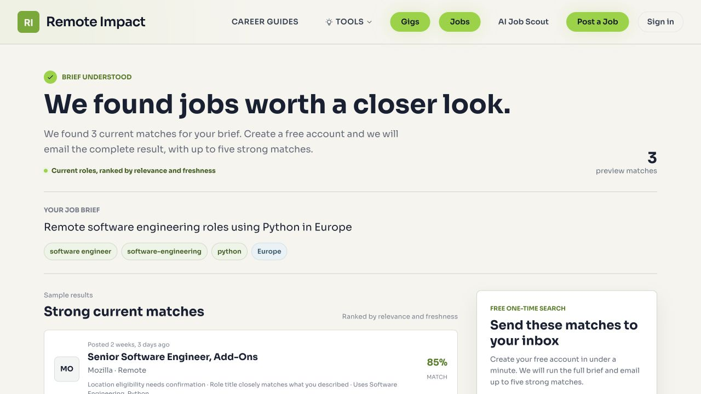

# Remaining Quality Fixes: 2026-10-03

## Implemented and Deployed

- Daily cleanup now verifies a bounded sample of source links. Never-checked
  records and the least recently checked records take priority; a cooldown
  prevents repeatedly checking the same oldest postings. Only 404/410 responses
  deactivate records. Blocked pages, ambiguous redirects, and request failures
  are recorded as unverified, not counted as evidence of availability.
- Source extraction retains JSON-LD JobPosting descriptions, qualifications,
  education, experience, and salary fields that were previously discarded with
  scripts. Multiple openings without an exact matching title are rejected.
- Source enrichment prioritizes thin descriptions and generic categories,
  scans past recently attempted candidates instead of starving older records,
  and applies retry cooldowns. Recovered descriptions retain source provenance.
- Education and experience values must belong to supported choices and have
  evidence quotes. Nonfinite salary values are rejected without crashing.
- Thin descriptions cannot pass the public quality threshold merely by having
  other metadata. Unknown salary/education values remain unknown.
- Worldwide Scout requests require explicit worldwide eligibility and reject
  regional restrictions. Generic Remote labels do not establish worldwide
  eligibility. Other location searches may include uncertain candidates, but
  put a visible eligibility warning first and cap their heuristic fit score at
  85 instead of displaying a misleading perfect fit.
- Quality bulk updates now invoke indexing signals. Lexical indexes were
  rebuilt and 3,667 stale embeddings were regenerated after the initial bounded
  pass. The daily pipeline
  includes up to 50 stale embedding repairs using the existing local model;
  embedding refresh sets its content hash to avoid double inference.
  The post-repair check found zero stale embeddings and zero stale lexical
  vectors under the existing content-hash/index definitions.
- My Matches now applies the public expiry/freshness/quality gate both during
  candidate retrieval and when loading cached results. Its cache version was
  advanced after the index repair so old ranking scores are not reused.
- Reimports preserve recovered values and local verification provenance when
  upstream fields are missing, retain full descriptions during partial refreshes,
  and no longer revive confirmed-dead destinations merely because an aggregator
  still lists them.

## Cleanup Results

The deterministic pass recovered 10 salary ranges, six experience levels, two
education requirements, 18 country values, and 12 skill sets from existing
evidence. Source-page passes improved 17 records across 45 attempts. These are
updated records, not necessarily 17 salary/education additions. A separate
30-link verification found 16 title-confirmed pages, four dead pages, and ten
unverified results. Four dead records were deactivated, not deleted.

Public snapshot after cleanup and new imports: 6,839 listings; 6,845 active
records. Missing salary: 48.8%; experience: 17.8%; education: 59.9%. Country
missing: 0; skills missing: three. Categories, search vectors, and embeddings
are present throughout the public inventory. No public thin-description issues
remain; 323 records still have generic categories. Completeness does not prove
that a location or category is correctly inferred, and source evidence may
legitimately omit salary and education requirements.

## Verification

- 177 targeted regression tests passed; Django system checks and diff checks
  passed. Final public audit: 86 checks passed; authenticated audit: 30 passed.
- Live Python-in-Europe preview still returns three candidate jobs, now showing
  eligibility uncertainty instead of asserting a confirmed location match.
- Stripe live account reports charges/payouts enabled, no currently due account
  requirements, and an enabled production webhook. Invalid signatures receive
  HTTP 400. The email sending domain is verified in Resend.
- No real payment was charged or email sent. Synthetic authenticated QA changes
  were rolled back. Real payment completion and inbox deliverability remain
  unverified; verified configuration is not a completed transaction.
- Changes were deployed using `/opt/easyclaw/deploy.sh fast`. Daily pipeline
  changes will take effect on its next existing scheduled invocation; no new
  automation or additional schedule was created in this turn.

Raw logs: `/tmp/remoteimpact-live-audit-20261003.log`,
`/tmp/remoteimpact-live-flows-20261003.log`,
`/tmp/remoteimpact-remaining-final-tests-20261003.log`, and
`/tmp/remoteimpact-integrations-20261003.log`.

Production source-verification report:
`/opt/easyclaw/repo/jobs/.audit-source-verification-20261003.json`.

